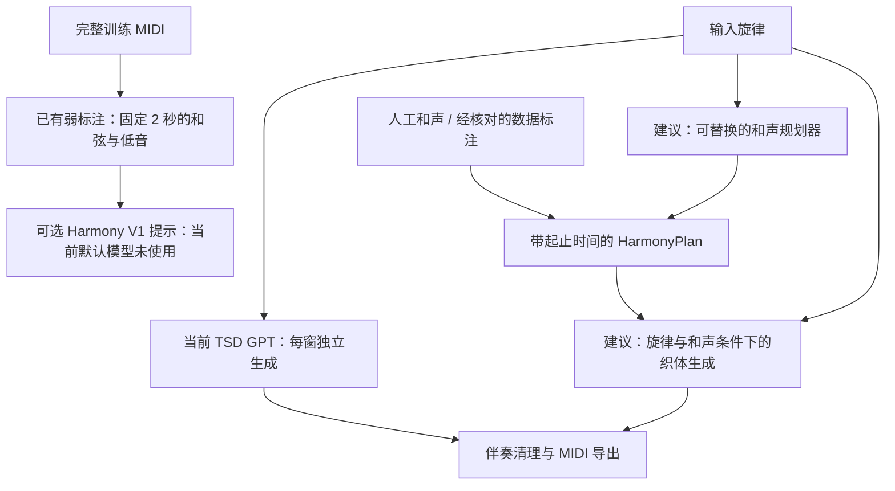

# 和声与织体分阶段设计审查

审查日期：2026-11-08。范围是「训练标注 → 带时间的和声条件 → 伴奏生成 → 评估」，重点检查语义归属、信息边界、验证可解释性和迁移成本。本轮核对了本地实现和上游官方仓库；以下是设计建议，没有新训练模型，也没有修改生成算法。

## 判断与整体结构

建议先验证显式和声条件下的织体生成，再接自动和声规划。两阶段有直接的上游依据，但不能据此断言 40 首曲子足够、过拟合被解决，或某种表示是唯一最优解。此前 TSD 实验主要验证编码、语法和时间覆盖，没有证明和声正确。

最关键的边界是 `HarmonyPlan`：它应说明哪个时间段采用什么和声、低音，以及依据从何而来。识别器、人工编辑和规划器可以产出同一种语义对象，织体模型不必知道每种算法的实现。序列化、窗口裁切和模型版本兼容由 codec/数据层统一处理，不能让调用者猜测每个 `BAR` 到底是多少秒。

## 已核实的项目问题

1. 当前 `model_output/accompaniment_gpt2_tsd_v2_e20/training_metadata.json` 中的训练格式为 `[BOS] source_melody [SEP] target_accompaniment [EOS]`。默认模型没有和声条件，已有和弦 token 并不表示模型使用或服从了它们。
2. `scripts/harmony_v1.py:214` 的 `label_piece_harmony` 按秒分段，默认流程采用 2 秒。2 秒只有在特定速度/拍号下才对应小节；和声也不一定一小节只变一次。
3. `scripts/harmony_v1.py:233` 的 `harmony_tokens_for_labels` 只输出 `BAR, CHORD, BASS, CONF`，丢弃标签的 `start/end`。对于开头被裁切、非整段或速度变化的窗口，模型缺少明确的时间对齐信息。交错 token 本身不能弥补这项信息损失。
4. `scripts/harmony_v1.py:108` 把片段内最低音作为 bass 候选。它可能是短暂经过音；最低音也不一定是根音。当前置信度为人工加权分数，没有校准为正确概率。
5. `scripts/import_pop909.py:48` 只保留 sidecar 文件路径，没有把 POP909 的和弦时间段和拍点内容用于训练。此前下载的四首样本也没有进入当前模型训练。

已有版本标识、声部独立编码、原曲级数据划分、原始输出诊断和参考窗口配对值得保留。这些提供了比较不同条件方式的基础，不需要推翻当前训练闭环。

## 对引文的技术修正

- **序列化不会必然丢失同时性。** 相同起音/拍位和显式时值足以描述复调。代价是模型需要适当的归纳偏置，以及平铺事件较长；这不是 Transformer 无法表示和声的证明。
- **QKV 的解释只能是可能学到的模式。** `softmax(QKᵀ/√d)V` 没有预设「和声协和度」，也不保证出现专门盯住 Pitch >72 的注意力头。token 位置不等于音乐时间，是否学到了时间差和声部关系需要探针、干预或消融证据。当前模型生成伴奏时能看到提示中的整段旋律，包括该窗口内较晚的旋律音，并非只能看到过去的音乐。
- **40 首是否够用取决于任务和初始化。** 条件化通常可降低不确定性，但不能增加独立歌曲、调性、织体或乐句的覆盖。多个窗口也不是独立曲目。用通用伴奏数据预训练再微调，或把 40 首作为检索织体库，是更有依据的候选实验。
- **两阶段仍有错误传播。** 错和声会约束下游生成；模型也可能忽略和声。训练中有准确和声、推理中只有预测和声，会出现条件分布差异。
- **和弦识别与旋律和声化是不同问题。** 从完整编配中估计 chord 是 annotation；从单旋律选择一套合理进行是 harmonization。后者通常有多个成立的答案，不能把现有伴奏识别器直接当成旋律规划器。
- **低音不能替代完整和声。** 低音 C 可以对应多种和弦或转位。应区分 root、quality/chroma 与 bass，而非只统计频率最高的音。
- **交错表示和更低 loss 都不是成功保证。** 带明确时间位置的独立和声前缀也是可用方案，交错需要实测比较。更多条件可让预测更容易，但要验证生成是否遵守条件以及听感是否改善。
- **Piano-roll diffusion 和多流 Transformer 是备选架构。** 前者仍要解决分辨率、起音/延音和音乐结构，后者需要可靠声部划分与跨流协调；没有依据把它们称为普遍最优解。
- **等价目标并非完全不可用。** 移调、受限转位和织体变换可作增广，虽然不能自动保证艺术家风格。能合成某些受限训练样本，也不等于已经解决开放域生成。

## 可直接学习的上游

| 上游与出处 | 核实到的内容 | 本项目的采用价值与限制 |
| --- | --- | --- |
| [AccoMontage2，ISMIR 2022](https://github.com/billyblu2000/AccoMontage2/blob/master/docs/README.md)；[论文](https://arxiv.org/abs/2209.00353) | 在 AccoMontage 上增加和声生成，输出和弦骨架 MIDI 与完整伴奏；接口需要 tonic、phrase segmentation，可控制和声风格与织体密度 | 最直接的系统参考。官方接口目前限定 4/4 和 4/8 小节乐句，且需要外部数据/权重；不能当作任意 MIDI 的无条件替换件 |
| [AccoMontage，ISMIR 2021](https://github.com/zhaojw1998/AccoMontage/blob/main/readme.md)；[论文](https://arxiv.org/abs/2108.11213) | 高层规则优化与学习式风格迁移组合，核心为乐句选择和风格迁移；支持指定织体参考曲目 | 值得比较「少量风格曲目作为织体供体」与「从零训练」。其更新后的接口能力不能直接套用到 AccoMontage2 的旧接口 |
| [Poly-Dis，ISMIR 2020](https://github.com/ZZWaang/polyphonic-chord-texture-disentanglement)；[model.py](https://github.com/ZZWaang/polyphonic-chord-texture-disentanglement/blob/master/model.py) | 代码分别编码和声与织体，再联合解码；和声重建分 root/chroma/bass | 支持显式区分和声与织体这一研究方向。加入 CHORD 前缀不等于已经完成这种表示解耦。仓库提示代码可能不完整，[教学版](https://github.com/ZZWaang/icm-deep-music-generation)移除了训练代码 |
| [POP909，ISMIR 2020](https://github.com/music-x-lab/POP909-Dataset)；[001 和弦文件](https://github.com/music-x-lab/POP909-Dataset/blob/master/POP909/001/chord_midi.txt) | 分轨角色，以及带秒级起止的和弦、拍点等标注；示例包含 `N`、`B:maj`、`F#:maj7/5` | 优先接入真实 sidecar，保留变化时间和转位语义。属于提取标注，不应默认视为人工金标准；斜杠后的音级必须按标注语法解析，不能当作 MIDI 音高 |
| [REMI / Pop Music Transformer，ACM MM 2020](https://github.com/YatingMusic/remi)；[论文](https://arxiv.org/abs/2002.00212) | 仍使用一维事件序列，通过节拍表示提供韵律上下文，支持和弦进行控制 | 支持先补时间结构和条件控制再比较模型架构；官方仓库列出的训练数据为 775 首，并非 40 首足够的证据 |
| [chorder / Dechorder](https://github.com/joshuachang2311/chorder) | 基于 miditoolkit 的符号 MIDI 和弦识别，提供 root/quality/bass，能按拍输出 chord | 可作为本地标注器的对照基线；需要在本项目华彩、琶音和转位样例上测错，不能直接当真值。pretty_midi 的 chroma 特征也不是完整和弦分析器 |

证据范围为上述官方说明、样例文件及 Poly-Dis 模型代码，本轮未复现这些上游模型的性能。

## 方案比较与建议边界

| 方案 | 改动与收益 | 成本/风险 | 建议 |
| --- | --- | --- | --- |
| A：保留 TSD GPT，先接人工或核对过的带时间和声 | 可隔离验证「给对和声时能否生成合适织体」；保留当前训练与诊断 | 新条件格式仍需新训练；模型可能忽略条件 | 先做 |
| B：和声规划器 + 条件织体模型，并使用外部数据预训练/检索供体 | 能独立替换规则、HMM、检索或学习式 planner，控制整曲和声 | 上游错误传播；数据域差异与乐句处理需要评估 | A 的条件利用得到验证后接入 |
| C：同时换成 diffusion / 多流模型 | 可研究不同的表示归纳偏置 | 同时改变多个变量，难判断改善来自何处；数据问题仍在 | 保留为后续对照 |

保留当前无和声模型作为基线，因为它能回答增加条件究竟带来多少收益。仅继续训练它无法直接验证用户要求的和声控制。把规划和织体完全合并会失去人工纠错和定位能力；把 root、bass、chroma 各自拆成独立服务则会拆散同一个和声事件的语义，暂时没有必要。接口宜命名为 `HarmonyPlan`，避免用泛化的 `Context` 把节奏、调性、风格等不同语义无约束地混装。

建议最小事件包含 `start_tick/end_tick`、`root_pc`、`quality`、`bass_pc`，统一引用乐曲的 PPQ/tempo map；对扩展和弦可保留 pitch-class mask 与原始 symbol。另保存 `source`、缺失/未知状态和可选置信度。生成器从该计划获得窗口内的明确位置，后续可以比较独立前缀与交错表示。先保留同一 TSD 音符表示，避免同时更换表示、模型和数据集导致对照不可解释。

## 边界失效推演

| 可能的误用 | 防护方式 | 剩余限制 |
| --- | --- | --- |
| 将训练标注器需要的真实伴奏传给推理 planner | planner 的输入接口只接受旋律、时间轴和显式用户条件；oracle 与自动规划评估分开 | 预测和声仍可能错误 |
| 将第 k 个 CHORD 默认解释为第 k 小节或 2k 秒 | 明确时间轴、半开区间和窗口裁切；标注缺口保留为未知，不能静默挪位 | 原 MIDI 的拍点/速度也可能不可靠 |
| CHORD 存在于输入，但模型完全忽略 | 同一留出旋律，替换两套合理和声；另做乱序/移除条件的诊断，检查低音与和声响应 | 响应条件仍不等于听起来好 |
| 将所有非和弦音一律判错或屏蔽 | 区分强拍持续冲突、经过音、延留及扩展和弦；保留音乐人盲听 | 自动指标只覆盖部分音乐合理性 |

## 优先实验

1. 选 10–20 段留出旋律，人工核对拍点、换和弦时间、和弦性质与低音，形成固定的小型审听集；不得用于调参后仍宣称完全未见测试集。
2. 用同一计划输出简单柱式和弦/平滑配位的基线。先判断是和声计划不合适，还是模型把正确计划渲染坏了。
3. 接 POP909 sidecar，并修复 Harmony V1 的时间信息丢失；验证窗口切分前后和弦覆盖的是同一段音乐。标注算法对照包括现有规则与 Dechorder，低置信度片段保留待审。
4. 固定原曲划分，比较 A 无条件、B 原配和声/人工核对和声条件、C 自动规划和声条件。B 是已知和声的诊断条件，不能作为「只有旋律」时的自动性能。
5. 同一条件模型上做和声替换、移除和乱序诊断。B 比 A 好而 C 退化，重点改 planner；B 也无改善，重点检查时间对齐、条件利用和织体模型。
6. 将和声适配与控制响应、低音及终止式、强拍冲突、声部进行和盲听作为主要证据。覆盖率、语法合法率、loss 作为辅助指标。Style 评估单独进行，避免把密集音符误当作目标风格。

推荐先完成「给定正确和声，伴奏能否正确响应」这个可证伪问题。第一阶段可以先由人工提供，不要求两个阶段都训练神经网络；也无需先把整个生成器换掉。
