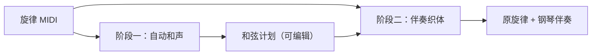

# Pianalysis

**输入一段旋律，自动配和声，再生成完整的钢琴伴奏。**

Pianalysis 把钢琴伴奏生成拆成两个可以分别训练、分别检查的阶段：先从旋律预测带时间信息的和弦进行，再以旋律和和声为条件生成伴奏织体。两个阶段分别微调自 [ReaLchords](https://github.com/lukewys/realchords-pytorch) 和 [Compose & Embellish](https://github.com/slSeanWU/Compose_and_Embellish)。



## 为什么分两阶段

项目最初用自训的小模型直接从旋律生成伴奏，V1–V5 迭代中逐步引入显式和声、配器与节奏控制。听审中反复遇到同一个问题：听起来像是模型出错，追查下去其实是和弦计划错了，比如弱起没识别出来、换和弦的位置不对。端到端模型很难把这两类错误分开。

所以现在把和声作为一个显式的中间表示：

- **定位错误**：和声可以先用柱式和弦单独试听、手动修改，确认无误后再生成织体。
- **数据各取所需**：和声阶段能用大量只有旋律–和弦配对的数据（Hooktheory），织体阶段只在真实钢琴伴奏上学习。

## 方法

**阶段一：自动和声。** 从 ReaLchords 的离线 encoder–decoder 权重出发，在每拍四格的网格上根据旋律预测 on/hold 和弦序列。微调时给和弦起始 token 1.5 倍损失权重，用 12 个调的移调做数据增强，并按来源加权采样（POP909-CL 0.7 / Hooktheory 0.3）。

**阶段二：伴奏织体。** 把 Compose & Embellish 的 Stage 2（在 Pop1K7 上预训练的 GPT-2）改成"旋律 + 和弦 → 伴奏"的条件生成：旋律和和弦作为条件 token 输入，损失计算在伴奏生成序列上（包括边界与结束 token），条件部分不计损失。训练样本是按严格时值标准筛出来的 4/4 拍四小节窗口（起音误差 ≤ 0.05 拍，时值误差 ≤ 0.125 拍）。生成时避开伴奏起音时刻旋律正在占用的音高，生成后再把原旋律逐音合并回去，所以输出里的旋律和输入完全一样。

**防止数据泄漏。** 训练、验证、测试集按作品组划分，用并查集把同名、同出处、移调后旋律指纹相同的片段合成一组，避免同一首歌的不同版本同时出现在训练集和测试集里。

**可复现。** 所有数据和上游权重都固定到具体的 commit / revision 并校验 SHA256。训练支持断点续训（包括 RNG 状态）、早停和运行时长上限；Colab 端用分片打包上传，checkpoint 写完后才标记完成并做校验。

## 结果

| 阶段 | 初始权重 | 选用 checkpoint | 记录的最佳验证 NLL |
| --- | --- | --- | ---: |
| 自动和声 | ReaLchords `enc_dec_base_chord_3_datasets` | 第 2488 步 | 0.312（验证时不加起始权重） |
| 伴奏织体 | Compose & Embellish `pop1k7` | 第 1900 步（第 2700 步早停） | 1.311 |

两项均为 teacher-forcing 验证；和声数值是该 checkpoint 记录的训练期间最佳值，并非第 2488 步单独重测的结果。

最终以听审结果为准。前期实验发现 loss、和弦内音比例这类指标和实际听感并不总是一致：V5 部分指标比 V4 好，听审时却还是选了 V4。

- **5 段自写旋律**（各 8 小节）：自动和声先经柱式试听确认，再原样用于织体生成，没有手动修改，整体通过听审。
- **24 段新旋律 × 3 个固定种子**，一共 72 次织体生成，串联试听整体通过。

## 局限与下一步

- 目前只支持 4/4 拍，且需要已知小节起点，还不能自动识别弱起。
- 训练窗口是四小节，已验收生成是八小节；更长段落的曲式结构尚未验证。
- 听审是单人的整体评价，还缺少量化评测和对照基线。ReaLchords 预训练时用过 POP909，因此 POP909-CL 上的验证结果不能完全代表泛化能力。
- 下一步计划：用"真实和声 / 预测和声 × 基准织体 / 新织体"交叉对比来分清误差来源，再加入风格控制和长程结构。

## 复现

需要 Python 3.11 和 NVIDIA GPU，以下以 CUDA 12.1 为例：

```bash
python -m pip install torch==2.5.1 --index-url https://download.pytorch.org/whl/cu121
python -m pip install -r requirements-auto-accompaniment.txt

python scripts/fetch_auto_accompaniment_data.py     # 下载数据（固定版本）
python scripts/prepare_auto_accompaniment_data.py   # 解析、分组、划分
python scripts/fetch_auto_models.py                 # 下载上游权重
python scripts/verify_auto_training_data.py         # 校验数据

python scripts/run_auto_training.py harmony --output-dir model_output/harmony_run1 --max-hours 2
python scripts/run_auto_training.py texture --output-dir model_output/texture_run1 --max-hours 2
```

训练配置见 [harmony_train.json](examples/auto_accompaniment/harmony_train.json) 和 [texture_train.json](examples/auto_accompaniment/texture_train.json)。续训时加 `--resume <运行目录>/last.pt`，脚本会检查数据和训练配置是否与原运行一致。上面结果表中的模型是在 Colab 上训练的，实际配置（精度、梯度累积等）以 checkpoint 中保存的为准，和示例配置不完全相同。

### Colab

```bash
python scripts/estimate_auto_training_cost.py
python scripts/package_auto_training.py
```

把 `data/auto_accompaniment/` 下生成的 `.partNNN` 分片和 `.manifest.json` 上传到 `MyDrive/Pianalysis/inputs/`，然后打开 [Pianalysis_Train.ipynb](colab/Pianalysis_Train.ipynb)，选择训练阶段和时长。日志和 checkpoint 会保存到 `MyDrive/Pianalysis/runs/`。

## 数据与许可

| 数据 | 规模 | 用途 |
| --- | --- | --- |
| [POP909-CL](https://github.com/AndyWeasley2004/POP909-CL-Dataset) | 811 首 | 和声 + 钢琴伴奏 |
| [Hooktheory](https://github.com/chrisdonahue/sheetsage)（CC BY-NC-SA 3.0） | 22,889 个片段 | 仅和声 |

代码采用 [LICENSE](LICENSE) 中的许可，代码许可不覆盖数据及作品本身的权利。上游项目声明见 [THIRD_PARTY_NOTICES.txt](examples/auto_accompaniment/THIRD_PARTY_NOTICES.txt)，数据和模型的来源与版本见 [data_sources.json](examples/auto_accompaniment/data_sources.json) 和 [model_sources.json](examples/auto_accompaniment/model_sources.json)。微调后的权重暂不公开。
