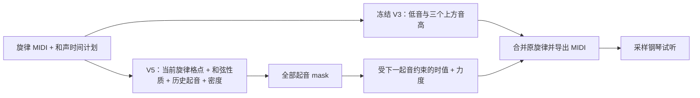

# V5：密度条件与起音优先的节奏生成

V5 在给定旋律和三和弦时间计划下生成局部伴奏节奏。它沿用冻结的 V3 配位模型，在 V4 上增加两项变化：**疏密条件**，以及**先生成全部起音、再预测时值和力度**。V5 尚未取代已通过听审的 V4。

## 1. 输入、输出与职责



- 和声计划记录 `ppq`、`duration_ticks`，每段给出 `start_tick/end_tick`、和弦符号、根音、低音和音级集合。它来自外部标注，不由 V5 预测。
- 当前只支持大/小三和弦、每四分音符四格，以及每段 1–16 格（最多四拍）。时间必须落在该网格上；未知/无和弦区间不生成伴奏，跨缺口重置历史。
- V3 预测四个音高；V5 的三条上方通道按相对根音顺序对应根、三、五音。持续低音、总力度尺度、MIDI 合并仍由规则提供。
- V5 不学习完整低音节奏、八度配置、踏板或宏观曲式。伴奏升八度和钢琴音色都是独立试听处理。

## 2. 数据与目标

配置见 [`trusted_subset_v5.json`](examples/harmony/trusted_subset_v5.json)，实验设置见 [`rhythm_v5_experiment.json`](examples/harmony/rhythm_v5_experiment.json)。固定 POP909 提交 `d83e6edba6872a704f5d3b8b32f5cb540088dae6`，先按歌曲划分，再选择片段；旧 V4 的 67 段及划分不变。

| 用途 | 曲目 | 片段 |
| --- | --- | ---: |
| 训练 | 001、002、005–010 | 135 |
| 验证、选择检查点 | 003、011 | 35 |
| 留出评估 | 004、012 | 25 |

合计 12 首、195 段；另有尾奏的 8 段仅供外部试听。标注经过符号证据复核，未宣称全部通过人工听审。

[`rhythm_v4.project_reference`](scripts/rhythm_v4.py) 从真实 PIANO 轨建立目标：分离指定低音音级的最低八度音；排除跨边界延续的上方音作为新起音；把上方和弦音合并到三条音级通道，再量化起音、时值与相对力度。同音级八度重复会合并，重触发会裁短前音。**核对页的规则分解不参与节奏训练。**

本批投影得到 1,383 个上方起音；分离 234 个低音，排除 55 个跨界上方延音，合并 19 个八度同音，194 个参考时值因重触发裁短。因此目标是有损的局部节奏表示，并非原钢琴编配的完整重建。

## 3. 表示与解码

实现集中在 [`scripts/rhythm_v5.py`](scripts/rhythm_v5.py)，复用 V4 的格点、音级和渲染逻辑。

| 部分 | 内容 |
| --- | --- |
| 条件前缀 | 段长、大/小性质、上一段起音 mask、当前旋律各格起音数与相对根音音级、密度档位 |
| 起音阶段 | 每格给定 `STEP`，预测 `MASK`（0–7，三位分别表示三条通道是否起音） |
| 细节阶段 | 按格点和通道顺序，仅为已起音通道预测 `DURATION` 与 `VELOCITY` |
| 力度档位 | 相对倍率 0.75、0.90、1.05、1.20；基础力度按旋律力度缩放 |

示意序列：

```text
[BOS] 条件前缀 DENSITY_medium [SEP]
[ONSETS_PHASE] STEP_0 MASK_... STEP_1 MASK_... ...
[DETAILS_PHASE] STEP_0 DURATION_... VELOCITY_... ... [EOS]
```

训练屏蔽条件前缀、padding、给定 `STEP` 和阶段标记的损失，只学习输出事件与 EOS。生成按已知格数完成两阶段，逐字段做合法范围内的贪心选择，不靠 EOS 决定段长。训练使用参考历史，生成递推自身历史，暴露偏差仍在。

密度按上方起音数 / 四分音符数分为 `sparse ≤2`、`medium >2 且 ≤3`、`dense >3`。训练样本从参考伴奏提取档位，数量分别为 35、69、31；**自由生成由调用者指定档位，不读取参考伴奏**。它是软条件，没有音符配额，不能保证输出严格落入对应区间。

全部起音已生成后，`duration_limit` 查找同通道下一起音。当前格为 `s`，上限为“下一同通道起音格 − s”；若没有下一起音，则为“总格数 − s”。例如 16 格中起音在 0、4、10，则最长时值依次为 4、6、6 格。解码仅允许 `1..上限`，从而避免长音覆盖同通道下一起音或越过和弦末端。这是表示和解码约束的保证，不等于模型独立学会了声部衔接。

## 4. 训练与实现入口

| 文件 | 关键职责 |
| --- | --- |
| [`build_trusted_harmony.py`](scripts/build_trusted_harmony.py) | 检查源哈希、标注与歌曲划分，构建 `annotations.json` |
| [`rhythm_v5.py`](scripts/rhythm_v5.py) | `profile_for` 分箱；`training_sample` 组织两阶段目标；`predict` 生成；`duration_limit` 限制时值 |
| [`train_rhythm_v5.py`](scripts/train_rhythm_v5.py) | `--protocol v4/v5` 在同批数据上训练，按验证 NLL 选择检查点 |
| [`generate_rhythm_v5.py`](scripts/generate_rhythm_v5.py) | 校验旋律/计划、调用冻结 V3 与 V5、导出 MIDI 和逐段预测 |
| [`evaluate_rhythm_v5.py`](scripts/evaluate_rhythm_v5.py)、[`verify_rhythm_v5.py`](scripts/verify_rhythm_v5.py) | 同输入比较六种方法，核验音符、元数据、密度和哈希 |

模型是 2 层、4 heads、96 维 GPT-2，V5 词表 96、参数 257,664，上下文 256，最长实测序列 128。AdamW：lr `4e-4`、weight decay `0.02`、dropout `0.2`、batch 16；seed 42，warmup 后余弦调度，最多 250 轮，每 10 轮验证，连续 8 次未改善早停。本次最佳检查点是第 20 轮，第 100 轮停止。

V5 验证 NLL 为 1.301675，使用参考密度进行 teacher forcing，仅用于选择检查点。它与 V4 的条件和输出顺序不同，NLL 不能横向当作音乐质量排名。

## 5. 对照结果与保留 V4 的原因

所有方法共享冻结 V3 配位。已验收 V4 使用原 39 个训练片段；扩充 V4 与 V5 使用同样 135 段。主比较固定 V5 中等档，另报告稀疏、密集和固定分解。

| 指标 | 已验收 V4 | 扩充 V4 | V5 中等 | 固定分解 |
| --- | ---: | ---: | ---: | ---: |
| 验证起音 F1 | 0.6497 | 0.6600 | 0.5904 | 0.4585 |
| 留出起音 F1 | 0.5266 | 0.5329 | 0.5234 | 0.3123 |
| 留出共同起音时值 MAE（四分音符） | 0.2045 | 0.1705 | 0.1629 | — |

F1 按“格点 × 音级通道”对投影参考计算，排除规则低音；时值行只比较三种模型共同命中的 66 个事件。它们衡量参考接近度，不是听感评分；留出数据仅两首、单次训练种子。

- 13 个案例的平均密度都满足稀疏 < 中等 < 密集；203 段中全部不递减，147 段严格递增。软条件有效，但不保证每段都有严格差别。
- V5 三档在本批导出中均无需重触发裁短；旧 V4 在留出集有 19 次，扩充 V4 有 1 次。表示变化与扩充数据都影响了这一结果。
- 反转旋律格点顺序后，V5 验证 NLL 从 1.301675 变为 1.301782，变化很小，仍缺少有效利用旋律时序的证据。
- 用户对尾奏反馈“已验收V4更自然”。之后只删音、改部分时值或力度的干预均被认为自然，尚未定位单一原因；没有因此将 V5 升为默认基准。

数字可在本地 `data/trusted_harmony_v5/evaluation/evaluation.json`、`data/trusted_harmony_v5/validation.json`、`model_output/local_rhythm_v5/training_results.json` 复核；这些生成物不在仓库中。版本化的[实验配置](examples/harmony/rhythm_v5_experiment.json)与[听审记录](examples/harmony/rhythm_v5_audition.json)保留比较口径和对应媒体哈希。

## 6. 运行方法

先按 [README](README.md) 安装依赖。构建需要配置中所指的本地 POP909 MIDI、和弦与拍点文件；训练/生成还需冻结 V3 权重 `model_output/local_voicing_v3/final_model`。没有权重时，先用 `trusted_subset_v3.json` 构建数据，再通过 `train_local_voicing.py` 训练 V3；具体参数可用 `--help` 查看。

用新目录构建 V5 数据并训练两个对照：

```powershell
python scripts/build_trusted_harmony.py --config examples/harmony/trusted_subset_v5.json --out-dir data/trusted_harmony_v5_new
python scripts/train_rhythm_v5.py --protocol v4 --annotations data/trusted_harmony_v5_new/annotations.json --output-dir model_output/local_rhythm_v4_expanded_new
python scripts/train_rhythm_v5.py --protocol v5 --annotations data/trusted_harmony_v5_new/annotations.json --output-dir model_output/local_rhythm_v5_new
```

已有 V5 权重与匹配的旋律、计划时生成：

```powershell
python scripts/generate_rhythm_v5.py --model model_output/local_rhythm_v5/final_model --melody-midi test/test1.mid --harmony-plan data/harmony_v2_review/plans/test1_pickup_4563.json --density medium --out-dir data/v5_preview
python scripts/render_piano_preview.py --input-midi data/v5_preview/output.mid --out-dir data/v5_preview_piano
```

上述示例用本地已验收尾奏，输入文件不随仓库提供；更换旋律必须同时更换匹配计划。新训练的权重应把 `--model` 改为对应的 `*_new/final_model`。`--density` 可选 `sparse/medium/dense`；生成目录包含 `output.mid`、旧合成试听 `output.wav` 和 `result.json`，第二条命令另生成采样钢琴，需先运行 `setup_piano_renderer.py`。

若要试听升八度，先用 `preview_accompaniment_register.py --input-midi ... --octaves 1 --out-dir ...` 生成 `shifted.mid`，再送入采样渲染器。不会自动升八度或修正碰到旋律的音符。

`evaluate_rhythm_v5.py` 目前使用固定实验路径，并拒绝覆盖已有结果，不是任意 `*_new` 目录的通用评估 CLI；它还依赖既有 V4/V3 听审产物。`verify_rhythm_v5.py` 核验该固定实验。所有生成/训练输出使用新目录，避免覆盖已验收媒体。

下一步先分开消融密度条件与预测顺序，再扩大独立旋律试听覆盖。尚未解决的旋律响应、长程结构与低音建模，不以增加训练轮数替代验证。
